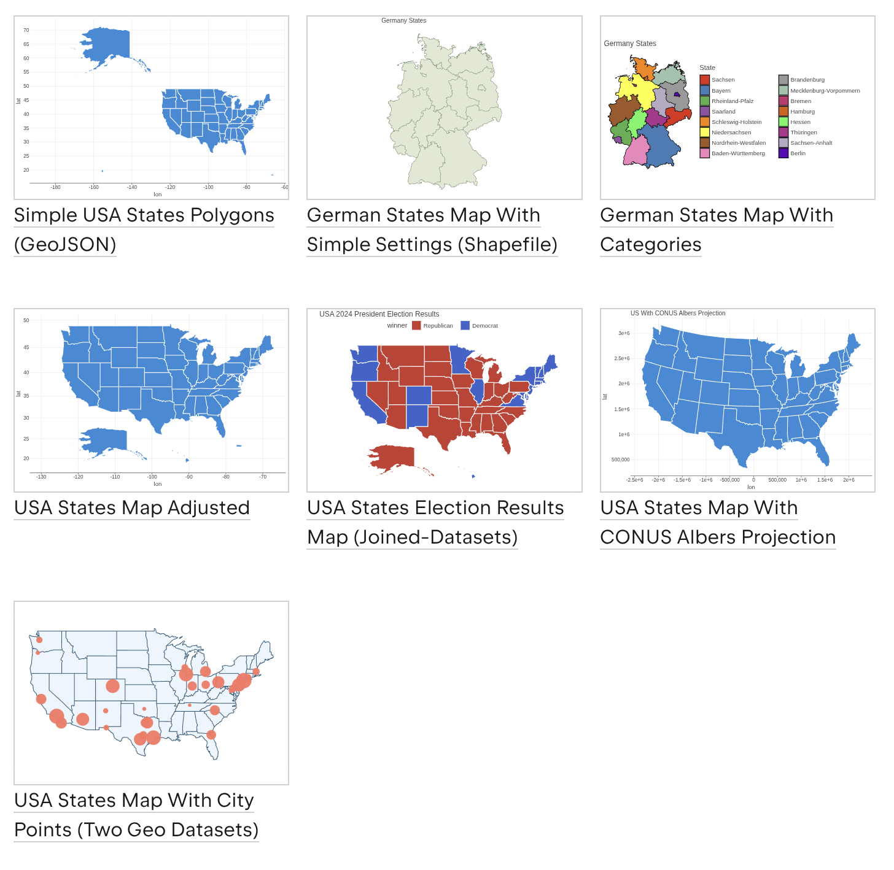

## :dataframe-geo

This module, published as `dataframe-geo`, provides functionality for working with geospatial data,
including support for reading and writing GeoJSON and Shapefile formats, as well as tools for manipulating geometry types.

Integrates with [Kandy](https://kotlin.github.io/kandy/welcome.html) for plotting:
- [Geo Guide](https://kotlin.github.io/kandy/geo-plotting-guide.html)
- [Geo Examples](https://kotlin.github.io/kandy/geo.html)

**Experimental**.
